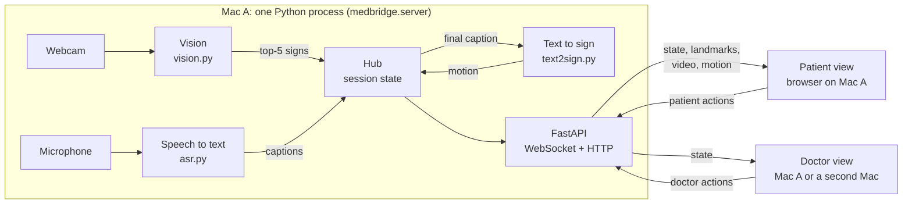
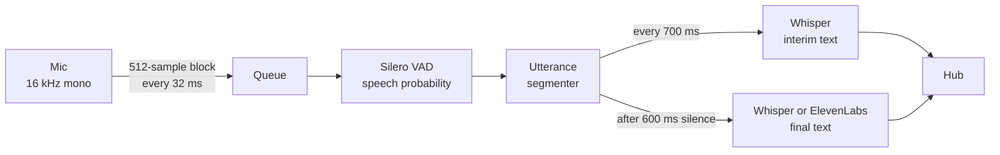
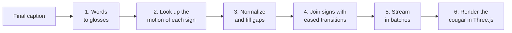
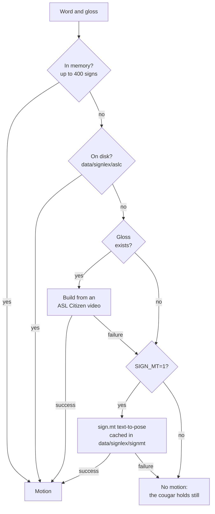
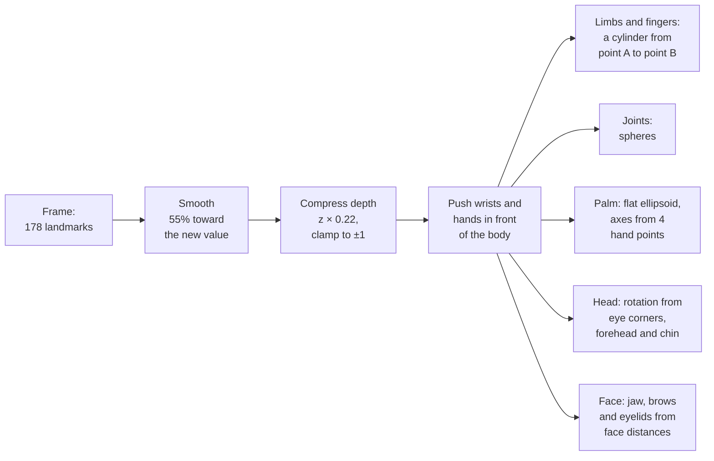
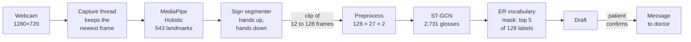
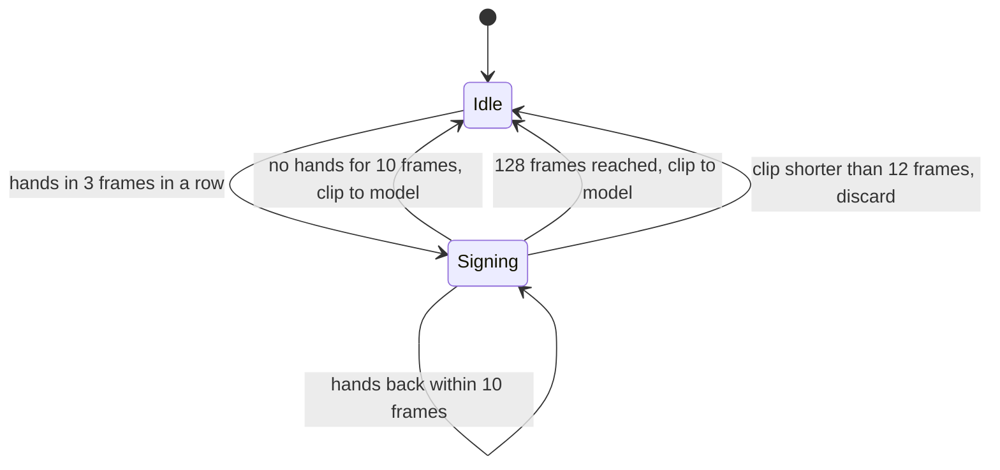
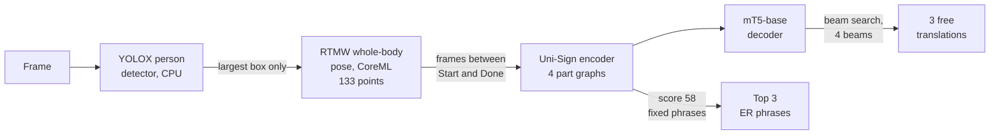

# SignWave system architecture

This document explains how SignWave works, step by step. Each section follows one data flow from its input to its
output. Each step names the file and the function that does it.

> **Current configuration.** Three features are built but switched off in the code:
> - natural (whole-sentence) signing ([section 9](#9-natural-signing-built-switched-off));
> - the sign chips with the top-5 picker on the patient view;
> - the System panel (fps and latency) on the doctor view.
>
> Sections 1 to 8 describe the system that runs now.

## Contents

1. [Terms](#1-terms)
2. [System overview](#2-system-overview)
3. [Startup](#3-startup)
4. [Flow A: speech to captions](#4-flow-a-speech-to-captions)
5. [Flow B: captions to 3D signing](#5-flow-b-captions-to-3d-signing)
6. [Flow C: patient signs to message](#6-flow-c-patient-signs-to-message)
7. [Flow D: message to voice (optional)](#7-flow-d-message-to-voice-optional)
8. [Shared state and transport](#8-shared-state-and-transport)
9. [Natural signing (built, switched off)](#9-natural-signing-built-switched-off)
10. [Privacy and network boundaries](#10-privacy-and-network-boundaries)
11. [Failure handling](#11-failure-handling)
12. [Configuration](#12-configuration)
13. [Measured performance](#13-measured-performance)
14. [Code map](#14-code-map)

---

## 1. Terms

This document uses each term below with one meaning only.

| Term | Meaning |
|---|---|
| Patient view | The web page at `/patient`. Dark theme. It shows the captions, the signing cougar, the camera and the message box. |
| Doctor view | The web page at `/doctor`. Light theme. It shows the conversation and a box to type a message. |
| Hub | The object that holds the session state ([hub.py](../medbridge/hub.py)). |
| State | One Python dict that holds the whole conversation. The hub sends a full copy of it (a *snapshot*) after each change. |
| Stream | A high-rate message that is not part of the state: landmarks, mic level, camera fps. |
| Caption | One line of doctor text. An *interim caption* changes while the doctor speaks. A *final caption* does not change, unless the doctor corrects it. |
| Sign | One ASL sign. |
| Gloss | The dataset name of a sign, for example `HURT` or `WANT1`. |
| Label | The English word that people see, for example *want*. One label can cover several glosses (`WANT1`, `WANT2`). |
| Landmark | One tracked point on the body, a hand or the face, as (x, y) or (x, y, z). |
| Motion | A sequence of frames at 30 fps. Each frame has 178 landmarks. The cougar plays motion. |
| Draft | The patient's message before the patient confirms it. |
| Message | A draft that the patient confirmed. Only messages go to the doctor view. |

## 2. System overview

All processing runs in **one Python process on one Mac** (Mac A). The browsers only show pages and send button
presses. The doctor view can also open on a second Mac on the same network.



Four data flows go through the system:

| Flow | Input | Output | Section |
|---|---|---|---|
| A. Speech to captions | The doctor's voice | Live captions on both views | [4](#4-flow-a-speech-to-captions) |
| B. Captions to signing | A final caption | The cougar signs the words | [5](#5-flow-b-captions-to-3d-signing) |
| C. Signs to message | The patient's signing | A confirmed message on the doctor view | [6](#6-flow-c-patient-signs-to-message) |
| D. Message to voice | A confirmed message | Spoken audio on the doctor view (optional) | [7](#7-flow-d-message-to-voice-optional) |

## 3. Startup

`python -m medbridge.server` does these steps:

1. `create_app()` reads `.env`. It makes the hub, the gloss translator, the signing worker and, if an ElevenLabs key
   is set, the speaker ([server.py](../medbridge/server.py)).
2. The signing worker starts its thread. It reads the index of the ASL Citizen dataset zip now, so the first new
   sign does not wait for it (`Builder.warm`).
3. Uvicorn starts the web server. The pages open at once and show "Loading…".
4. A `startup` thread loads the models (`start_engines`):
   1. It reads the 2,731 ASL Citizen glosses and the ER vocabulary (`data/medical_vocab.json`).
   2. It loads the ST-GCN sign model (3.8 M parameters) on the CPU.
   3. It opens the camera and starts the vision threads.
   4. It loads Whisper and runs it once on 1 s of silence. This warm-up makes the first real caption fast.
   5. It loads Silero VAD and opens the microphone.
5. The hub sets the status to "listening". Startup takes about 20 s.

The models load in a background thread. Thus the server answers at once, and the pages show the true status while
the models load.

## 4. Flow A: speech to captions



All steps are in [asr.py](../medbridge/asr.py).

1. **Capture.** The sounddevice callback receives 512 samples at 16 kHz (32 ms). It puts the block in a queue and
   reports the RMS level for the waveform. It does no other work, so the audio driver never waits (`MicAsr`).
2. **Voice detection.** The `asr` thread takes each block from the queue. Silero VAD gives the probability that the
   block contains speech.
   - **Loudness gate (optional, `MIC_GATE=1`).** If the block is quieter than `MIC_GATE_DB` (default −40 dBFS), its
     probability becomes 0, so the block counts as silence. The VAD alone is almost blind to loudness: speech at
     −60 dBFS is still "speech" in 89% of its blocks. Without the gate, people talking across the room start captions
     and keep them open until the 20 s limit. With the gate, the caption closes 0.6 s after the doctor stops. The gate
     works only if the doctor is clearly louder at the mic than the room, so use a mic close to the doctor.
     `scripts/check_devices.py --calibrate` measures both levels and suggests a value.
3. **Segmentation.** The `UtteranceSegmenter` uses that probability:
   - An utterance starts at the first block with probability ≥ 0.5. The 200 ms before it are kept (pre-roll), so the
     first syllable is not lost.
   - While the doctor speaks, the segmenter sends the audio so far every 700 ms. This gives an *interim caption*.
   - The utterance ends after 600 ms of silence. This gives the *final caption*.
   - An utterance with less than 250 ms of speech is dropped (for example, a cough or a click).
   - An utterance ends at 20 s, even without silence.
4. **Transcription.** `mlx-whisper` runs `whisper-large-v3-turbo` on the Apple GPU (`Transcriber`). The settings:
   - `language="en"`.
   - `initial_prompt` is a list of ER words (penicillin, ibuprofen, nitroglycerin, CT scan…). It biases the
     spelling. It does not insert text.
   - `condition_on_previous_text=False`. Each utterance is independent, so one error cannot repeat into the next.
   - If every segment has `no_speech_prob > 0.6`, the result is empty. This stops Whisper from inventing text from
     noise.
5. **Back-pressure.** If more than 10 blocks wait in the queue, the thread skips interim captions. It never skips a
   final caption.
6. **Optional cloud text.** With `ASR_ENGINE=elevenlabs`, ElevenLabs Scribe v2 writes the final caption
   (`ElevenLabsTranscriber`). Whisper still writes the interim captions. If the cloud call fails, Whisper writes the
   final caption.
7. **Hub update.** `hub.on_caption` stores the interim caption, or adds the final caption with a new id. Then the
   hub broadcasts the state. For an interim caption, the hub also starts the sign prefetch
   ([5.6](#56-prefetch-from-interim-captions)).

**Timing:** the final caption needs a median of 358 ms of compute, after the 600 ms silence wait (M4 Max).

**Doctor controls:**
- **Pause captions.** The mic callback drops all blocks. Pausing and resuming also clear the waiting audio, the
  utterance in progress and the VAD state. A caption still being transcribed at the pause is dropped. After resuming,
  listening starts again from silence.
- **Correct a caption.** The doctor clicks a caption and edits it. The hub keeps the original text. The doctor view
  shows the original text struck through. The patient view shows the new text, and the cougar signs it again.
- **Type a message.** The typed line becomes a caption, the same as a spoken one. The cougar signs it.

## 5. Flow B: captions to 3D signing

The cougar signs each final caption, word by word. The motion is the **recorded motion of Deaf signers** from the
ASL Citizen dataset. No model generates the motion.



Steps 1 to 5 run on the server ([text2sign.py](../medbridge/text2sign.py), `SignWorker` in
[server.py](../medbridge/server.py)). Step 6 runs in the patient's browser.

### 5.1 Words to glosses

`text_to_glosses` turns the caption into a list of (word, gloss) pairs, in English word order.

1. Split the caption into lower-case words.
2. Drop the words that ASL usually leaves unsigned: articles, forms of *be* and *do*, most prepositions (`UNSIGNED`).
3. Join word pairs that are one sign, for example *thank you* (`BIGRAMS`).
4. Map synonyms and digits: *I'm* → *me*, *medication* → *medicine*, *experiencing* → *feel*, *6* → *six*.
5. Look up the word in the lexicon. If there is no match, try simple stems: -s, -es, -ies, -ing, -ed.

The lexicon (`build_lexicon`) maps each English word to one gloss. It prefers the plain variant: not fingerspelled
(`W.H.A.T`), not number-prefixed (`8HOUR`), and the lowest number (`DOCTOR1`).

Real output:

| Caption | Signs |
|---|---|
| "Are you experiencing chest pain?" | YOU · FEEL · *chest (no local sign)* · PAIN |
| "Thank you, I'm going to give you ibuprofen for the pain." | THANKYOU · ME · GO · GIVE · YOU · *ibuprofen (no local sign)* · PAIN |

> This is word-by-word signing in English order. It is not ASL grammar. The captions stay the reference.

### 5.2 Motion lookup

Each sign gets its motion from the first source that has it:



**Build from an ASL Citizen video** (`AslCitizenSigns._build`):

1. Download one video of the sign from the 42.8 GB dataset zip. HTTP range requests (`remotezip`) read only that one
   file.
2. Run MediaPipe Holistic on each frame. Keep 178 landmarks per frame ([5.7](#57-motion-data-format)).
3. Score the clip by *hand coverage*: the share of frames with a tracked hand, from the first such frame to the last.
4. If the coverage is 0.8 or more, accept the clip. If not, try the next clip of the same sign (up to 3), and keep
   the best one.
5. Trim the clip to the frames with hands, plus 3 frames on each side. Resample it to 30 fps.
6. Save it to `data/signlex/aslc/<GLOSS>.npy`. The save goes to a temporary file first, then a rename. Thus no other
   thread can read a half-written file.

`scripts/build_sign_lexicon.py` builds the doctor's likely words ahead of time. The cache now holds 384 ASL Citizen
signs and 593 sign.mt words.

**sign.mt** is an open text-to-pose service. SignWave sends it only words that have no local sign, and only from
final captions. Its output is often fingerspelling.

### 5.3 Normalize and fill gaps

1. `normalize` moves the origin to the mean shoulder midpoint. It scales the motion so that the mean shoulder width
   is 1. Thus signs from different signers and cameras join at the same size and position.
2. `fill_gaps` fills a tracking dropout of up to 8 frames with a straight line, point by point. Thus a hand does not
   flicker out in the middle of a sign. A longer gap stays empty.

### 5.4 Join signs

`assemble` joins the signs of one caption into one motion.

- Between two signs, it adds 8 transition frames. Each one blends the last pose of the first sign into the first
  pose of the next sign, with smoothstep easing `t²(3 − 2t)`.
- The blend handles missing points: if a point is missing on one side, it takes the value from the other side.
- A word without motion holds the last pose for 18 frames (0.6 s).
- For each word, the timeline records the start frame, the end frame and the source (`aslc`, `signmt` or `none`).

### 5.5 Stream in batches

The `SignWorker` thread builds the motion for the newest final caption.

1. All sign lookups of the caption start at the same time, on a pool of 4 threads.
2. The worker joins the signs in word order. A batch closes at 12 words, or when the next sign is not ready within
   50 ms. Thus a slow sign does not hold back the ready signs before it.
3. If a sign is not ready 8 s after it is needed, it is left out this time. Its build continues, so it is ready the
   next time.
4. After each batch, the hub publishes `signing = {caption_id, status, frames, build, done}`.
5. If a newer caption arrives, the worker stops the current caption. Only the newest caption is built.
6. A corrected caption gets a new `build` number. The page sees the new number and restarts the motion.

**Effect:** four new words took 30.7 s before this design. Now they take 4.5 s. A caption of cached words starts at
once.

### 5.6 Prefetch from interim captions

For each interim caption, the hub calls `Builder.prefetch`. It starts the ASL Citizen lookups for words that are
not cached yet. When the final caption arrives, those signs are often ready. Interim text never goes to sign.mt.

### 5.7 Motion data format

The motion is a float32 array with the shape (frames, 178, 3) at 30 fps. A missing point is NaN.

```
index      points  content
0 - 7         8    body: L/R shoulder, L/R elbow, L/R wrist, L/R hip
8 - 135     128    face: a subset of the MediaPipe face mesh (eyes, brows, lips, outline)
136 - 156    21    left hand
157 - 177    21    right hand
```

The page requests `/api/signing/{caption_id}?start=N`. The answer has at most 720 frames (24 s), base64-encoded.
The page adds each part to the motion it already has, then requests the next part.

### 5.8 Render the cougar

[SigningStage.tsx](../web/src/components/SigningStage.tsx) and [cougar.ts](../web/src/lib/cougar.ts) render the
motion with Three.js in the patient's browser.

**Scene**

- One WebGL renderer with a transparent background. The stage colour comes from CSS, so the themes can change it.
- One perspective camera with a 30° field of view.
- Three lights: a hemisphere light, a white key light and a warm rim light.
- A soft contact shadow under the cougar, drawn from a radial gradient on a canvas.
- The camera sways slowly left and right (±0.3 rad). It stays still if the operating system asks for reduced
  motion.

**Posing: no skeleton rig.** Each frame places simple shapes directly on the landmarks.



- **Limbs and fingers.** A cylinder spans each pair of points: shoulder to elbow, elbow to wrist, and 3 segments
  per finger. The cylinder's position is the midpoint. Its rotation turns its Y axis onto the segment. Its length is
  the distance between the points. Each hand uses all 21 points, so the handshape is the recorded handshape.
- **Palm.** A flat ellipsoid. One axis runs from the little-finger knuckle to the index knuckle. The other axis runs
  from the wrist to the middle knuckle.
- **Closed paw.** If the wrist is tracked but the hand is not, a closed paw shows at the wrist.
- **Torso and neck.** The torso is an ellipsoid from the shoulders toward the hips. The neck is a cylinder from the
  shoulder midpoint to the head.
- **Head.** The X axis runs from the right eye corner to the left eye corner. The Y axis runs from the chin to the
  forehead, made perpendicular to X. Each frame, the head turns halfway toward the new rotation.
- **Face.** The jaw opens with the gap between the lips. The brows move with the brow-to-eyelid distance, compared
  with a slowly adapting baseline. The eyelids follow the gap between the lids. All three are divided by the face
  height, so the distance to the camera does not change them.
- **Depth.** MediaPipe depth is noisy. The page multiplies z by 0.22 and clamps it. It also pushes the wrists and
  hands in front of the torso, so the paws never go into the jersey. (sign.mt motion has no useful depth.)
- **Look.** `MeshToonMaterial` with a 3-step gradient gives cel shading. The outlines use the inverted-hull method:
  each mesh has a slightly larger dark copy that shows only its back faces.

**Playback**

- A clock advances by the frame time × the speed (0.6×, 1×, 1.5× or 2×).
- If the next batch has not arrived, the clock waits on the last frame.
- After the last frame, the cougar holds the pose for 1 s.
- The URL parameter `?frame=N` freezes the cougar on one frame, to check the rendering.

**Caption highlight**

1. For each frame, the page finds the word whose frame range contains the current frame.
2. The transition into a sign counts as part of that sign. Thus the highlight does not blink between words.
3. A word without motion is never highlighted.
4. `signedWordSpans` ([text.ts](../web/src/lib/text.ts)) maps the signed word back to the words of the caption. The
   patient view marks those words in orange.

## 6. Flow C: patient signs to message



### 6.1 Camera

All steps are in `Vision` in [vision.py](../medbridge/vision.py).

1. The `capture` thread reads frames from the camera (AVFoundation) at 1280×720. A wider frame is scaled down to
   1280 px wide.
2. The `capture` thread keeps only the newest frame. It does not queue frames.
3. The `vision` thread takes the newest frame when it is free. If processing is slow, old frames are dropped. Thus
   delay never builds up.
4. After processing, the frame is encoded as a JPEG (quality 70) for the preview at `/video.mjpg`.
5. Frames exist only in memory. Nothing goes to disk.

The patient view mirrors the preview with CSS, as a mirror does. The model always sees the frame without mirroring,
as in the training videos. A mirrored frame would swap the left and right hands.

### 6.2 Landmarks

MediaPipe Holistic gives an array of 543 × (x, y) in the ASL Citizen training layout (`holistic_to_array` in
[islr.py](../medbridge/islr.py)):

```
index       points  content
0 - 32        33    pose
33 - 53       21    right hand
54 - 74       21    left hand
75 - 542     468    face mesh
```

A part that is not detected stays 0. The hand and arm points also go to the patient view as a `landmarks` stream.
The page draws them over the video.

### 6.3 Sign segmentation

The patient signs one sign, then puts the hands down in the lap. *Hands active* means that the frame has at least
one hand landmark ([segmenter.py](../medbridge/segmenter.py)).



- The clip starts 8 frames before the first hand frame (pre-roll).
- At the end, the clip keeps 8 frames after the hands go down (post-roll). It drops the other empty frames.
- At 30 fps, the end of a sign needs 10 frames without hands: 0.33 s.

### 6.4 Preprocessing

`preprocess` in [islr.py](../medbridge/islr.py) is a line-for-line port of the ASL Citizen training code. A test
compares its output with the upstream code ([test_islr.py](../tests/test_islr.py)).

1. Make the clip 128 frames long. Pad a short clip with zeros. Downsample a long clip evenly.
2. Compute the centre (the mean shoulder midpoint) and the scale (the mean shoulder distance) over all 128 frames.
3. Subtract the centre. Divide by the scale.
4. Reorder the points to pose, left hand, right hand. Keep 27 points: the nose, the eyes, the shoulders, the elbows,
   and 10 points per hand (the wrist, the thumb tip, and the base and tip of each other finger).
5. Output a tensor with the shape (1, 2, 128, 27) = (batch, x and y, time, points).

> Step 2 includes the zero padding in the mean. This looks like a bug. It is what the model saw in training, so the
> port keeps it.

### 6.5 Model and vocabulary

1. **ST-GCN.** 10 spatial-temporal graph convolution blocks (64, then 128, then 256 channels) run over a graph of
   the 27 points. A linear layer gives a score for each of the 2,731 ASL Citizen glosses (`load_stgcn`). The model
   needs about 10 ms per clip on the CPU (M4 Max, preprocessing included).
2. **ER vocabulary mask** (`topk`):
   1. Keep only the scores of the 149 glosses in `data/medical_vocab.json`.
   2. Apply softmax to those scores only.
   3. Add the probabilities of glosses that share a label. Example: `CRY1` + `CRY2` + `CRY3` + `CRY4` → *cry*.
   4. Return the top 5 of the 129 labels.
3. **Confidence.** If the top probability is below 0.3 (`PRECISE_THRESHOLD`), the sign is *uncertain*. An uncertain
   sign does not go into the draft. (The sign chips are switched off, so the patient does not see it now.)

ASL Citizen has 52 Deaf and hard-of-hearing signers. The training split has 35 signers. The test split has 11 other
signers. All accuracy numbers use the test signers.

### 6.6 Draft and confirmation

1. The hub joins the chosen labels into the draft (`_rebuild_precise_draft` in [hub.py](../medbridge/hub.py)).
   - `GLOSS_TRANSLATOR=literal` (default): "Stomach hurt."
   - `GLOSS_TRANSLATOR=llm`: the patient sees the literal text at once. A thread asks Claude (`claude-haiku-4-5`)
     to rephrase it: "My stomach hurts." The answer replaces the draft only if no newer sign arrived and the
     patient did not edit the draft.
2. The patient can:
   - press **Edit** to change the draft;
   - press **Retry** to clear it;
   - switch sign recognition **Off**. While it is off, the camera image shows, but no frame is read for signs.
3. **Confirm & send** moves the draft into `messages`. The doctor view shows only messages, each with a check mark.

**Rules for Claude** ([translate.py](../medbridge/translate.py)):
- The system prompt forbids new symptoms, body parts, times, quantities or other details.
- `max_tokens=60`, a 3 s timeout, no retries.
- Any error returns the literal text.

## 7. Flow D: message to voice (optional)

This flow is on only if `ELEVENLABS_API_KEY` is set ([speech.py](../medbridge/speech.py)).

1. The doctor view reads `/api/config`. If speech is on, it shows the **Auto audio** button.
2. For each new message, the page requests `/api/speech/{id}`.
3. The server sends the message text to ElevenLabs (`eleven_flash_v2_5`) and receives an MP3. It keeps the last 50
   MP3s in memory. Two requests for the same message make only one call.
4. Before it returns the MP3, the server **mutes the microphone** for the audio length + 1 s. It calculates the
   length from the MP3 size and the bitrate. Thus the doctor's microphone does not caption the patient's voice as
   doctor speech.
5. If the browser blocks autoplay, the button shows "off". The doctor clicks it once, and the missed message plays.

## 8. Shared state and transport

### 8.1 Hub

- One state dict, protected by one re-entrant lock ([hub.py](../medbridge/hub.py)).
- Engine threads call the `on_*` methods. WebSocket clients call `apply(msg, role)`.
- After each change, the hub broadcasts a **full snapshot** (a deep copy). It sends no diffs:
  - a client that reconnects gets the full, correct state at once;
  - the state holds only text, so a full copy is small.

### 8.2 Roles and access

Each WebSocket connects with `?role=patient` or `?role=doctor`. The hub accepts only the actions of that role.

| Role | Actions |
|---|---|
| Patient | `draft.edit`, `draft.confirm`, `draft.clear`, `sign.enable`, `sign.pick`, `sign.remove` (natural mode: `mode.set`, `candidate.pick`, `sign.start`, `sign.done`) |
| Doctor | `caption.correct`, `caption.add`, `asr.pause`, `asr.resume`, `session.end` |

The patient role and the camera stream are served only to the Mac itself (loopback address), unless
`PATIENT_LAN=1`. Another machine on the network can open only the doctor view.

### 8.3 WebSocket fan-out

`Clients` in [server.py](../medbridge/server.py):

- Engine threads call `broadcast` from any thread. It passes the message to the event loop with
  `call_soon_threadsafe`.
- Each connection has its own ordered queue and its own writer task.
- `landmarks` go only to patient connections.
- If a client has more than 20 queued messages, new `landmarks` and `level` messages for it are dropped. State
  snapshots are never dropped.
- The browser reconnects after 300 ms, then doubles the wait up to 4 s ([useMedbridge.ts](../web/src/lib/useMedbridge.ts)).

The browser keeps the 30 fps streams (landmarks, mic level) in React refs, not in React state. A canvas loop reads
the refs. Thus the streams do not re-render the page.

### 8.4 Threads

| Thread | Job |
|---|---|
| Uvicorn event loop | HTTP, WebSockets, broadcast queues |
| `startup` | Loads the models, then stops |
| `capture` | Reads camera frames, keeps the newest one |
| `vision` | Holistic, sign segmenter, ST-GCN, JPEG encoding |
| sounddevice callback | Puts mic blocks in the queue |
| `asr` | VAD, utterance segmenter, Whisper |
| `signing` | Builds the motion for the newest caption |
| `signs` pool (4 threads) | Downloads and tracks new signs |
| Short-lived threads | Claude rephrasing (only with `GLOSS_TRANSLATOR=llm`) |

## 9. Natural signing (built, switched off)

Natural signing reads a whole signed sentence. The code is in the repository but commented out, because its accuracy
on ER phrases is too low (`NaturalEngine` in [vision.py](../medbridge/vision.py),
[unisign_runner.py](../medbridge/unisign_runner.py)).



1. **Pose.** rtmlib whole-body pose. YOLOX finds the people. It runs on the CPU, because it crashes the CoreML
   provider of onnxruntime. RTMW poses only the largest person, on CoreML (about 4× faster than the CPU). Live rate:
   30 fps.
2. **Recording.** The patient taps **Start** (3-2-1 countdown), signs, and taps **Done** (or presses Space). The
   limit is 30 s. An earlier rule ended the sentence when the hands went low. It failed: STOMACH is signed at belly
   height and looked like rest in 98–100% of its frames.
3. **Encoder.** Uni-Sign (ICLR 2025), pose-only, fine-tuned on OpenASL. Four graph networks (body, left hand, right
   hand, face) feed the mT5-base language model. The frames are sampled evenly to at most 256, so the output does not
   change between runs.
4. **Free translation.** Beam search with 4 beams returns 3 sentences.
5. **Phrase bank.** The model scores each of the 58 phrases in `data/er_phrases.json` by *teacher forcing*: the mean
   log-probability per token of the phrase, given the signing (`UniSignPose.rank` in
   [unisign/model.py](../medbridge/unisign/model.py)). One encoder pass serves all the phrases.

**Results on held-out Deaf signers:** the right phrase is first 53% of the time and in the top 3 66% of the time
(chance: 1.7%). The free translation of ER phrases is right about 0% of the time.

## 10. Privacy and network boundaries

| Data | Leaves the Mac? | When | How to keep it local |
|---|---|---|---|
| Camera video | Never | — | — |
| Mic audio | Only with `ASR_ENGINE=elevenlabs` | Each finished utterance | `ASR_ENGINE=whisper` (default) |
| Caption words | Only words without a local sign | Final captions only | `SIGN_MT=0` |
| Sign labels | Only with `GLOSS_TRANSLATOR=llm` | Each change to the draft | `GLOSS_TRANSLATOR=literal` (default) |
| Message text | Only if `ELEVENLABS_API_KEY` is set | Each message played | Leave the key empty |
| Which sign is needed | A download request: the byte range it asks for identifies the sign, so the server can tell which word was needed | First use of a sign that is not cached | Build the cache ahead of time (`scripts/build_sign_lexicon.py`) |

- Audio and video stay in memory. There are no recordings.
- The conversation stays in memory until **End session**.
- `METRICS_LOG=1` writes only timings, scores and sign labels. It writes no text, audio or video.

## 11. Failure handling

| Failure | What the system does |
|---|---|
| The camera does not open, or a read fails | Status `no_camera`. The `capture` thread tries again every 0.5 s. The page reloads the video every 2 s. |
| The cloud speech-to-text call fails | Whisper writes the final caption. |
| The Claude call fails (key, network, API error) | The draft keeps the literal text. |
| An ASL Citizen download fails | sign.mt for that word. If sign.mt also fails, the cougar holds still. |
| A sign is not ready 8 s after it is needed | Left out this time. Ready the next time. |
| A browser reads too slowly | High-rate streams are dropped for it. State snapshots are not. |
| The WebSocket drops | The page reconnects and receives a full snapshot. |
| A sign result arrives after recognition is switched off | The hub drops it. |
| Ctrl+C while a video stream is open | Shutdown waits at most 2 s. |

## 12. Configuration

Set in `.env` (see [.env.example](../.env.example)).

| Variable | Default | Effect |
|---|---|---|
| `CAMERA_INDEX` | 0 | Camera index (AVFoundation) |
| `MIC_NAME` | system default | Part of the microphone name |
| `PRECISE_THRESHOLD` | 0.3 | Below this probability, a sign is uncertain |
| `GLOSS_TRANSLATOR` | literal | `llm` = Claude rephrases the signs |
| `ANTHROPIC_MODEL` | claude-haiku-4-5 | Model for rephrasing |
| `SIGNING` | 1 | 0 = captions only, no cougar |
| `SIGN_MT` | 1 | 0 = local signs only |
| `ASR_ENGINE` | whisper | `elevenlabs` = final captions from ElevenLabs |
| `MIC_GATE` | 0 | 1 = mic sound quieter than `MIC_GATE_DB` counts as silence (noisy room) |
| `MIC_GATE_DB` | −40 | The loudness gate in dBFS. Find it with `check_devices.py --calibrate`. |
| `ELEVENLABS_API_KEY` | empty | Set = the patient's messages are spoken |
| `PATIENT_LAN` | 0 | 1 = the patient view also opens from other machines |
| `METRICS_LOG` | 0 | 1 = write `data/metrics.jsonl` |

## 13. Measured performance

The team's own pipeline code produced these numbers on held-out data (`scripts/eval_*.py`). The
[README](../README.md#measured-results) has the full table.

| Part | Test | Result |
|---|---|---|
| Sign recognition (ER vocabulary) | 339 held-out clips of ER signs | top-1 **86.1%**, top-5 **98.5%** |
| Sign recognition (all 2,731 signs) | 150 random held-out clips | top-1 60.7%, top-5 88.0% (paper: 59.5%, 82.7%) |
| Sign model compute | One clip, CPU, M4 Max | about 10 ms |
| Doctor speech to text | 20 ER sentences × 4 synthetic voices | WER **1.5%**, medical terms 100% |
| Caption delay | End of speech to final caption | 600 ms silence wait + 358 ms median compute |
| Camera pipeline | MacBook camera, M4 Max | 30 fps (the camera's limit) |
| Text to sign | 4 new (not cached) words | 4.5 s (was 30.7 s) |
| Natural signing (off) | 220 phrases, 5 held-out signers | right phrase 1st 53%, top 3 66% |

## 14. Code map

| Path | Role |
|---|---|
| [medbridge/server.py](../medbridge/server.py) | FastAPI app, WebSocket fan-out, startup, `SignWorker`, HTTP endpoints |
| [medbridge/hub.py](../medbridge/hub.py) | Session state, role-checked actions, drafts, messages |
| [medbridge/asr.py](../medbridge/asr.py) | Mic capture, VAD, utterance segmenter, Whisper, ElevenLabs Scribe |
| [medbridge/text2sign.py](../medbridge/text2sign.py) | Words to glosses, sign motion cache, sign.mt, joining, batches |
| [medbridge/vision.py](../medbridge/vision.py) | Camera threads, precise engine, natural engine |
| [medbridge/segmenter.py](../medbridge/segmenter.py) | Hands-up / hands-down sign segmenter |
| [medbridge/islr.py](../medbridge/islr.py) | ST-GCN loading, preprocessing port, vocabulary mask |
| [medbridge/stgcn/](../medbridge/stgcn/) | Vendored ASL Citizen ST-GCN (MIT) |
| [medbridge/translate.py](../medbridge/translate.py) | Literal text or Claude rephrasing |
| [medbridge/speech.py](../medbridge/speech.py) | ElevenLabs voice for patient messages |
| [medbridge/unisign/](../medbridge/unisign/), [unisign_runner.py](../medbridge/unisign_runner.py) | Natural signing (off): Uni-Sign pose-only, rtmlib pose |
| [medbridge/metrics.py](../medbridge/metrics.py) | Opt-in timing log |
| [web/src/components/SigningStage.tsx](../web/src/components/SigningStage.tsx) | Three.js scene, motion download, playback clock |
| [web/src/lib/cougar.ts](../web/src/lib/cougar.ts) | The cougar: shapes, toon shading, per-frame posing |
| [web/src/components/PatientView.tsx](../web/src/components/PatientView.tsx) | Patient view: captions, highlight, camera, message box |
| [web/src/components/DoctorView.tsx](../web/src/components/DoctorView.tsx) | Doctor view: conversation, corrections, typing, audio |
| [web/src/components/CameraPanel.tsx](../web/src/components/CameraPanel.tsx) | Video preview and landmark overlay |
| [web/src/lib/useMedbridge.ts](../web/src/lib/useMedbridge.ts) | WebSocket client with reconnect |
| [scripts/](../scripts/) | Model download, sign cache build, evaluations, sign debugger |
| [data/medical_vocab.json](../data/medical_vocab.json) | 149 glosses → 129 ER labels |
| [data/er_phrases.json](../data/er_phrases.json) | 20 doctor sentences, 58 patient phrases |
