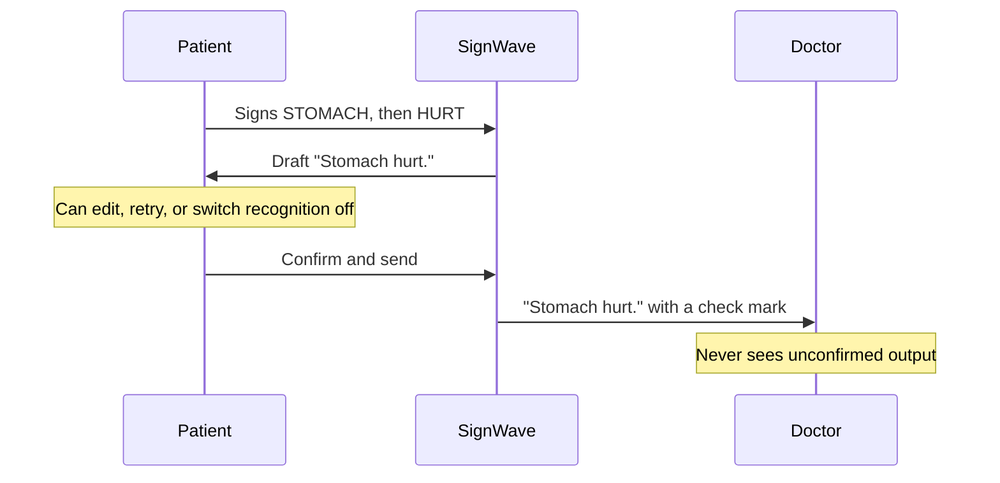
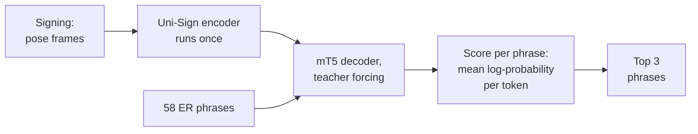
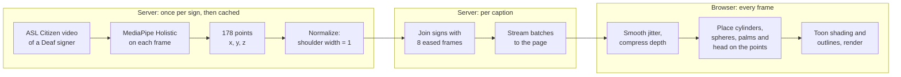
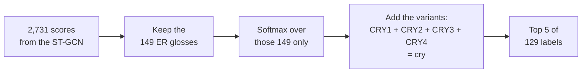

# SignWave: judge FAQ

These are questions that hackathon judges may ask, with answers taken from the code and the measured results.

- Each answer starts with a **short answer** that you can say in one breath. The detail below it is for follow-up
  questions.
- All numbers come from the team's own evaluation scripts (`scripts/eval_*.py`), unless a source is named.
- For how each part works, see [architecture.md](architecture.md).
- **[TEAM]** marks an answer that only the team can give. Fill it in before the event.

## Numbers to remember

| Number | Meaning |
|---|---|
| **86% / 98.5%** | Sign recognition, top-1 / top-5, on ER signs, by Deaf signers the model never saw |
| **129** | ER words the patient can sign |
| **1.5%** | Word error rate on doctor speech (synthetic voices). Medical terms: 100% right. |
| **≈ 1 s** | From the end of the doctor's speech to the final caption (600 ms wait + 358 ms compute) |
| **30 fps** | Live camera pipeline on a MacBook |
| **≈ 10 ms** | Sign model compute per sign, on the CPU |
| **4.5 s** | Four new words to signing motion (was 30.7 s). Cached words start at once. |
| **0** | Recordings saved. Audio and video stay in memory. |

## Contents

- [Part 1. Problem and product](#part-1-problem-and-product) — Q1–Q4
- [Part 2. Model choices](#part-2-model-choices) — Q5–Q12
- [Part 3. The 3D signing animation](#part-3-the-3d-signing-animation) — Q13–Q21
- [Part 4. Real-time engineering](#part-4-real-time-engineering) — Q22–Q31
- [Part 5. Accuracy and evaluation](#part-5-accuracy-and-evaluation) — Q32–Q39
- [Part 6. Safety, privacy and ethics](#part-6-safety-privacy-and-ethics) — Q40–Q44
- [Part 7. Build story and next steps](#part-7-build-story-and-next-steps) — Q45–Q47

---

## Part 1. Problem and product

### Q1. What does SignWave do, in one sentence?

**Short answer.** It lets a Deaf patient who signs ASL and an ER doctor talk from the first minute, live, on one
laptop.

- **Doctor → patient.** The doctor speaks. The patient reads live captions and watches a 3D cougar sign the words.
- **Patient → doctor.** The patient signs one sign at a time. The app builds a message. The patient confirms it.
  The doctor sees only confirmed messages.

### Q2. Hospitals already have video remote interpreting (VRI). Why build this?

**Short answer.** VRI takes time to set up, and it often fails Deaf patients. SignWave covers the gap until an
interpreter is available. It does not replace one.

Sources (from the team's pitch brief):
- Only 28.8% of Deaf and hard-of-hearing patients can communicate on their own with ER staff
  (Tannenbaum-Baruchi et al., *Acad Emerg Med* 2025, n = 288).
- Only 41% of Deaf patients were satisfied with VRI (Kushalnagar et al., *JMIR Rehabil Assist Technol* 2019,
  n = 555).
- Deaf ASL users stay about 30 min longer in the ER at the same acuity (James et al., *Acad Emerg Med* 2022).

### Q3. Do you want to replace interpreters?

**Short answer.** No. A qualified interpreter is the gold standard. SignWave is the bridge until the interpreter
arrives, and for the moments when no interpreter is there.

The README says this directly: SignWave is a research prototype, not a certified medical interpreter, and not for
clinical decisions.

### Q4. Why does the patient confirm each message, and not the doctor?

**Short answer.** Only the patient knows what they meant. The doctor cannot check ASL. So the person who checks the
message is the only person who can catch an error.



The app does not guess on weak results. A sign with a top probability below 30% does not go into the draft.

---

## Part 2. Model choices

### Q5. Which models do you use, and why each one?

| Job | Model | Why this one | Runs |
|---|---|---|---|
| Find speech in the mic | Silero VAD | Small and fast. Whisper runs only on speech, so it cannot invent text from silence. | On the Mac |
| Doctor speech to text | Whisper large-v3-turbo, through MLX | Strong open accuracy at high speed. On-device. 1.5% WER on our test. | Mac GPU |
| Body and hand tracking | MediaPipe Holistic | The same tracker that made the sign model's training data | On the Mac |
| Sign recognition | ASL Citizen ST-GCN (Microsoft, NeurIPS 2023) | Strongest open model for single signs. Trained on webcam video of Deaf signers. | Mac CPU |
| Signing motion | No model: recorded ASL Citizen motion | Real Deaf signers' motion. Nothing is generated. | On the Mac |
| Words with no local sign | sign.mt text-to-pose | Open service. Covers words that are not in the dataset. | Cloud, on by default (`SIGN_MT=0` turns it off) |
| Rephrase signs | Claude Haiku 4.5 | Fast and cheap. Follows strict rules. The task is tiny. | Cloud, opt-in |
| Final captions | ElevenLabs Scribe v2 | 0.9% WER on the same test | Cloud, opt-in |
| The patient's voice | ElevenLabs Flash v2.5 | Their lowest-latency voice model | Cloud, opt-in |
| Whole sentences (off) | Uni-Sign pose-only (ICLR 2025) + RTMW pose | Strongest open continuous model | Mac GPU and CoreML |

### Q6. Why not send the webcam video to GPT-5 or Gemini?

**Short answer.** General video models cannot read ASL yet. On the How2Sign benchmark they score about 1 BLEU:
Gemini 2.5 Pro 1.4, GPT-5 0.1. They would also send patient video to the cloud and add seconds of delay.

We checked the other options in October 2026:
- Google SignGemma: not released.
- Google SL2T: runs only on Pixel 11, no API.
- SHuBERT: no released translation checkpoint.

> Keep the source for the How2Sign numbers ready. The README gives the numbers without a citation.

### Q7. Why a skeleton (pose) model, and not a model that reads pixels?

**Short answer.** A skeleton removes what does not matter for the sign: skin, clothes, background and light. It
keeps what does matter: hand shape, position and movement. It is also small and fast, and no image needs to be kept.

- Input: 27 points × (x, y) × 128 frames = 6,912 numbers per sign.
- Model: 3.8 M parameters. About 10 ms per sign on the CPU.
- Only landmarks reach the model. Camera frames stay in memory and are then replaced.
- The trade-off: the skeleton loses what the tracker misses, for example fingers that hide each other. Some
  handshapes look alike as points.

### Q8. ASL Citizen's model is from 2023. Why not a newer one?

**Short answer.** It is still the strongest open model for single signs. It also matches our setting: it was
trained on webcam video from Deaf and hard-of-hearing signers, not on studio video.

- We reproduced the paper with our live code: 60.7% top-1 over all 2,731 signs, on 150 random held-out clips
  (paper: 59.5%).
- Code and weights are MIT-licensed.

### Q9. Why Whisper large-v3-turbo on MLX, and not a cloud API?

**Short answer.** It keeps the doctor's voice on the laptop, and it is accurate enough: 1.5% WER and 100% of
medical terms on our test.

- Turbo is Whisper large-v3 with 4 decoder layers instead of 32. It decodes much faster, with a small accuracy cost.
- MLX runs it on the Apple GPU.
- Three settings make it reliable for live use:
  1. A prompt with ER words biases the spelling of drug names.
  2. Each utterance is transcribed alone, so one error cannot repeat into the next.
  3. A no-speech filter drops text that Whisper invents from noise.
- ElevenLabs Scribe v2 is an option (`ASR_ENGINE=elevenlabs`). Whisper still writes the live text, and it takes
  over if the cloud call fails.

### Q10. Why Claude Haiku 4.5 for rephrasing? How do you stop it from adding symptoms?

**Short answer.** The task is small: turn 2 to 5 sign labels into one sentence. The fastest Claude model is
enough. Four layers stop it from changing the meaning.

1. The system prompt forbids new symptoms, body parts, times, quantities and other details.
2. The output limit is 60 tokens, with a 3 s timeout and no retries.
3. Any failure returns the literal text ("Stomach hurt.").
4. The patient reads the sentence before sending it. Nothing goes to the doctor without that.

Rephrasing is off by default. Natural-signing output never goes through an LLM.

**If they push** ("What if it turns NOT · PAIN into 'I'm in pain'?"): that risk exists for any rephrasing. The
patient confirmation step is there for exactly this case. That is also why literal text is the default.

### Q11. Why is whole-sentence signing switched off?

**Short answer.** We measured it, and it is not good enough for ER phrases. We prefer one sign at a time at 86%
to whole sentences at 53%.

Uni-Sign was trained on news and instructional video. It rarely saw body parts or symptoms. Its output for held-out
Deaf signers:

| Signed | The model's top output |
|---|---|
| HELLO | "Hello!" ✓ |
| STOMACH HURT | "He was heartbroken." |
| MY HEAD HURT | "I grew up in a home that had pain." |
| ME DIZZY | "I will become sick." |

The phrase bank (Q12) raises this to 53% first and 66% in the top 3. That is still below the 86% of one sign at a
time. The code stays in the repository, ready to switch back on.

### Q12. How does the phrase bank work?

**Short answer.** We do not ask the model to write a sentence. We ask it to score 58 fixed ER phrases, and we show
the 3 phrases it finds most likely for the signing.



- **Teacher forcing.** The decoder reads each phrase token by token and gives the probability of each token. The
  phrase score is the mean log-probability per token. The mean (not the sum) stops short phrases from winning by
  default.
- All 58 phrases share one encoder pass. Ranking adds only about 140 ms.
- Chance is 1.7% (1 in 58). The model puts the right phrase first 53% of the time.
- The limit: a phrase that is not in the bank can never be the answer. The bank is an editable JSON file.

---

## Part 3. The 3D signing animation

### Q13. How did you render the 3D signing animation?

**Short answer.** We do not animate by hand, and we do not generate motion. We take real Deaf signers' videos from
the ASL Citizen dataset, track 178 points of the body, face and hands in each frame, and pose a toon cougar on those
points in Three.js, 30 times per second.



- **Limbs and fingers** are cylinders between two tracked points. **Joints** are spheres. Each hand uses all 21
  points.
- **The palm** is a flat ellipsoid. Its axes come from the knuckles and the wrist.
- **The head** turns with the eye corners, the forehead and the chin.
- **The look:** `MeshToonMaterial` with a 3-step gradient (cel shading), and inverted-hull outlines.

The full step list is in [architecture.md, section 5](architecture.md#5-flow-b-captions-to-3d-signing).

### Q14. Is the signing generated by AI?

**Short answer.** No. Each sign is the recorded motion of a Deaf signer from ASL Citizen. AI only *tracks* the
motion (MediaPipe). It does not create it.

- Any of the 2,731 ASL Citizen signs can be built on first use. 384 signs are cached now.
- A word without an ASL Citizen sign comes from sign.mt, an open text-to-pose service. Its output is often
  fingerspelling. `SIGN_MT=0` turns it off.
- A word with no motion at all is not faked. The cougar holds still, and the caption does not highlight the word.

### Q15. Why not use a rigged 3D character with a skeleton, like a game character?

**Short answer.** Our data is point positions. A rig needs joint rotations. Converting points into rotations
(retargeting) adds errors, and in sign language a small finger error can change the meaning. We pose the cougar on
the points directly, so the handshape is the signer's handshape.

| | Rigged character | Direct posing (SignWave) |
|---|---|---|
| Input it needs | One rotation per bone | The 178 tracked points |
| Hands | Inverse kinematics must solve 15 finger joints per hand. The roll of each finger is ambiguous from points. | Each finger segment is a cylinder between two tracked points |
| Errors | Retargeting can change a handshape | No new errors. Only tracking errors. |
| Body sizes | Calibration for each rig | Normalized by shoulder width |
| Look | Smooth, skinned, realistic | Joints look like a toy. This fits a cartoon mascot. |
| Code | Rig, skinning, IK solver | About 290 lines (`cougar.ts`) |

The trade-off: the cougar is a set of connected shapes, not a smooth character. For a friendly mascot, this is
acceptable. The first version was a glowing stick figure. The cougar replaced it.

### Q16. How do you join separate signs smoothly?

**Short answer.** Between two signs, we add 8 frames (0.27 s). They blend the end pose into the next start pose
along an S-curve (smoothstep). The browser also smooths jitter on every frame.

- Smoothstep is `t²(3 − 2t)`. The movement starts slow, speeds up, and ends slow, as a real hand does.
- The blend handles missing points. If a hand is missing on one side, the blend uses the other side.
- Tracking dropouts of up to 8 frames are filled with a straight line.
- In the browser, each point moves 55% of the way to its new value per frame. This removes landmark jitter.

### Q17. ASL uses the face for grammar. Does the cougar show that?

**Short answer.** Partly. The cougar's jaw, brows and eyelids follow the signer's face in the recording. But each
recording is one isolated sign. So the face shows that sign's own expression, not sentence grammar such as the
raised brows of a question.

- **Jaw:** from the gap between the lips.
- **Brows:** from the brow-to-eyelid distance, compared with a slowly adapting baseline.
- **Eyelids:** from the gap between the lids.
- **Head:** rotation from the eye corners, the forehead and the chin.
- All measures are divided by the face height, so the distance to the camera does not change them.

**Honest limit:** this is word-by-word signing in English order. ASL word order and sentence-level facial grammar
are future work. The captions stay the reference.

### Q18. MediaPipe depth is noisy. How does the 3D still look right?

**Short answer.** We trust depth less than x and y. We compress depth to 22%, clamp it, and keep the hands in front
of the body.

- MediaPipe gives hand depth relative to the wrist. The server makes it absolute with the body's wrist depth.
- The browser multiplies z by 0.22 and clamps it to ±1.
- The wrists and hands always stay in front of the torso. Thus the paws never go into the jersey, even with sign.mt
  motion, which has flat depth.
- The camera sways slowly (±0.3 rad). This gives a sense of depth without exact depth values.

### Q19. How fast does a new word appear?

**Short answer.** A cached sign plays at once. A new sign takes a few seconds the first time (download one video,
track every frame). Then it stays cached. Four new words take 4.5 s.

How four new words went from 30.7 s to 4.5 s:
1. **A bug fix.** The clip-quality check counted the resting frames before and after the sign. So it nearly always
   failed, and two more clips were processed. Now it counts only the frames from the first hand to the last.
2. **Parallel lookups** on 4 threads.
3. **An early start.** Lookups begin from the interim caption, while the doctor is still speaking.
4. **Batches.** Signing starts before the last word is ready.
5. **Range requests** download one video from the 42.8 GB dataset zip, not the whole zip.

### Q20. How does the caption highlight stay in sync with the hands?

**Short answer.** The server sends a timeline with the start frame and end frame of each word. On each rendered
frame, the page finds the word that contains the current frame and highlights it.

- The transition into a sign counts as part of that sign. Thus the highlight does not blink between words.
- The speed buttons (0.6× to 2×) change only the clock. The timeline is in frames, so it stays correct.
- Unsigned words (*the*, *is*) are skipped when the page maps signs back to caption words, so the right word lights
  up.

### Q21. Why a cougar?

**Short answer.** **[TEAM: confirm the reason.]** CodeRED is the University of Houston's hackathon, and the UH
mascot is a cougar.

Technical facts, if asked:
- Toon shading (`MeshToonMaterial`, 3 brightness steps) and inverted-hull outlines give a cartoon look.
- The UH logo on the jersey is drawn from SVG paths onto a canvas at run time. No image file is needed.

---

## Part 4. Real-time engineering

### Q22. How do you get 30 fps on a laptop?

**Short answer.** Never queue frames. Run only the model that is needed. Put each model on the processor that suits
it.

- The capture thread keeps only the newest frame. If processing is slow, old frames are dropped. Delay never builds
  up.
- Only the active mode's pose model runs.
- Wide frames (1080p) are scaled down to 720p.
- The browser keeps the 30 fps streams in React refs, not in React state. They do not re-render the page.
- Whole-sentence mode (now off) needed two more fixes, which took it from 15 to 30 fps:
  - The person detector (YOLOX) crashes the CoreML provider of onnxruntime. So the detector runs on the CPU, and only
    the pose model runs on CoreML (about 4× faster).
  - Only the largest person is posed. A live scene often has about 9 detections, and posing all of them cost
    about 3×.

### Q23. How does the app know where one sign ends, without a button?

**Short answer.** Hands up starts a sign. Hands down in the lap for 10 frames (0.33 s) ends it.

- A sign starts after 3 frames in a row with a hand.
- The clip keeps 8 frames before the start and 8 frames after the end.
- A clip shorter than 12 frames is discarded. A clip ends at 128 frames.

Why not the same rule for whole sentences? We tried it. STOMACH is signed at belly height. A "hands low = rest"
rule called it rest in 98–100% of its frames, and it cut sentences in half. Whole-sentence mode now uses explicit
**Start** and **Done** buttons.

### Q24. What is the end-to-end latency?

```
Doctor -> patient
  doctor stops speaking
  |---- 600 ms silence wait ----|---- ~358 ms Whisper ----|  final caption on screen  (about 1 s)
                                                          |-> cached signs: the cougar starts at once
                                                          |-> a new sign: a few seconds, the first time only

Patient -> doctor
  patient lowers the hands
  |---- 333 ms (10 frames without hands) ----|-- ~10 ms ST-GCN --|  word in the draft
                                                                 |-> patient presses Confirm & send -> doctor view
```

- The interim caption appears while the doctor speaks, every 700 ms.
- All parts run on the same Mac. We did not measure the WebSocket delivery separately.

### Q25. Why does Python capture the camera and mic, and not the browser?

**Short answer.** One process owns the devices and the models, so frames never cross a network. The doctor's laptop
needs no camera or mic permission. It only opens a web page.

- The model sees the raw frame, without mirroring (Q29).
- Audio and video never leave the process memory.
- The browser receives only the preview (MJPEG) and the landmarks.

### Q26. Why send full state snapshots instead of small updates?

**Short answer.** Simplicity and correctness. A full snapshot cannot get out of sync, and a client that reconnects
is correct at once. The state holds only text, so it is small.

- High-rate data (landmarks, mic level, fps) goes on a separate stream, not in the state.
- For a slow client (more than 20 queued messages), stream frames are dropped. State is never dropped.
- Each connection has its own ordered queue.

### Q27. The doctor's mic can hear the patient's synthetic voice. Why is it not captioned as the doctor?

**Short answer.** The server mutes the mic for the length of the audio plus 1 s, just before it returns the audio.
It calculates the length from the MP3 size and the bitrate.

### Q28. What happens if the doctor corrects a caption while the cougar signs it?

**Short answer.** The server rebuilds the motion with a new build number. The page sees the new number, drops the
old motion, and plays the new one.

- The doctor view shows the original caption struck through.
- If the doctor says something new while a long caption is still building, the server stops the old build. Only the
  newest caption is built.

### Q29. Why is the camera preview mirrored, but the model input is not?

**Short answer.** People expect a mirror when they see themselves. The model expects the real image, as in its
training videos. A mirrored image swaps the left and right hands, and the model keeps the two hands as separate
inputs.

The mirror is only CSS on the patient view. The landmark overlay is inside the same mirrored element, so it stays
aligned with the video.

### Q30. What if two people are in the camera view?

**Short answer.** MediaPipe Holistic tracks one person. Seat the patient nearest to the camera, with the doctor out
of the frame.

Whole-sentence mode (now off) chooses the largest person in the frame, which is the person nearest to the camera.

### Q31. What if the patient also speaks while signing?

**Short answer.** One microphone hears everyone, so the patient's voice would appear as a doctor caption. The fixes
today: the doctor can pause captions, and `MIC_NAME` can select a microphone near the doctor.

This is an honest limit. Many Deaf people use their voice too. Speaker separation is future work.

---

## Part 5. Accuracy and evaluation

### Q32. Are your numbers from the papers, or from your own code?

**Short answer.** From our own code. Each number comes from running our live pipeline code on held-out data, with
the scripts in the repository.

| Script | What it measures |
|---|---|
| `scripts/eval_islr.py` | Sign recognition on held-out ASL Citizen signers |
| `scripts/eval_asr.py` | Speech-to-text WER and medical-term recall |
| `scripts/eval_unisign.py` | Uni-Sign BLEU on held-out OpenASL clips |
| `scripts/eval_phrase_bank.py` | Phrase-bank ranking for whole sentences |

- Parity tests compare our preprocessing with the upstream code of ASL Citizen and Uni-Sign (`tests/test_islr.py`,
  `tests/test_unisign_preprocess.py`).
- Our full-vocabulary result (60.7%) is close to the paper (59.5%). This shows that the port is correct.
- ASL Citizen has 52 Deaf and hard-of-hearing signers: 35 in training, 6 in validation, 11 in test. The test
  signers are never in training.

### Q33. Accuracy goes from 60.7% to 86.1%. Is the vocabulary mask cheating?

**Short answer.** No. It is the same model on the same held-out signers. In an ER, the patient needs about 130
words, not 2,731. Removing words that cannot occur makes the task smaller, and the score reports that smaller task.



The same 339 held-out clips of ER signs, decoded two ways:

| Decoding | Top-1 | Top-5 |
|---|---|---|
| All 2,731 signs | 59.6% | 85.5% |
| ER vocabulary | 86.1% | 98.5% |

Say the caveats:
- The cost: the patient cannot sign a word outside the list. The patient can type instead.
- The 86.1% was measured when the list had 103 labels. The last 24 words passed a separate check (Q34).

### Q34. How did you choose the 129 signs?

**Short answer.** We started from what a patient needs in an ER: yes/no, the pain scale, body parts, symptoms,
family and medicine. Then we kept only the signs that the model recognizes reliably on held-out signers.

The rule for the last 24 words:
1. The word is right on at least 80% of 5 held-out test videos.
2. The word does not harm the existing words. On the 345 test videos of the words already in the list, 298 were
   right before the change and 298 after it, and no correct prediction changed.

Left out: *phone* and *who* (each made an existing word go wrong), and *daughter*, *surgery*, *swallow* and *walk*
(under 80%). *Five* and *ten* are not in the list; the other numbers work.

### Q35. Your speech test used synthetic voices. Is 1.5% WER realistic?

**Short answer.** It is a repeatable baseline, not a real-world number. Real voices, accents, masks and ER noise
will make it worse. The script has a `--live` mode for a real speaker. That is the next measurement.

- The test: 20 ER sentences × 4 macOS voices, streamed through the real pipeline (VAD → segmenter → Whisper).
- One accent shows the risk. On an M2 Pro run, the voice "Aman" got 18.8% WER with Whisper and 0% with ElevenLabs
  Scribe.
- The same script gave Whisper 1.5% on the M4 Max and 5.6% on the M2 Pro. We have not isolated the cause.
- The doctor can correct any caption. The ER word prompt helps with drug names.

### Q36. Your Uni-Sign BLEU (15.5) is below the paper (22.7). Why?

**Short answer.** The test conditions are different. We used 60 of the 976 test clips and our live pose settings.
We did not isolate each cause. This is one more reason the mode is off.

- **Pose model.** The live pipeline uses the rtmlib "lightweight" model for 30 fps. The larger "performance" model
  scored lower (11.4 BLEU) and ran at about 6 fps.
- **Frame sampling.** We sample frames evenly, so the output does not change between runs. Upstream samples them at
  random.
- **Clips.** The clips were downloaded again from YouTube for this test.
- Our speed fixes raised the score from 14.1 to 15.5.

### Q37. The model always picks a word from the list. What about random movement or an unknown sign?

**Short answer.** Three guards. A weak top score (below 30%) does not go into the draft. The patient sees every word
before sending it. The patient can switch recognition off while they talk with their hands.

- The mask always produces a top 5, even for movement that is not a sign. That is why the threshold matters.
- The test protocol in [testing.md](testing.md) counts false recognitions: 2 minutes of movement that is not
  signing (scratching, drinking, adjusting glasses).
- Nothing reaches the doctor without **Confirm & send**.

**Honest limit:** the guard is one probability threshold, not a trained "not a sign" class.

### Q38. Your preprocessing includes the zero padding in the shoulder average. Isn't that a bug?

**Short answer.** It looks like one, but the model was trained that way. A model works best on inputs prepared
exactly like its training data. So we copied the upstream code line for line, including this, and we test it
against the upstream code.

How it works: a short clip gets zero frames added until it has 128 frames. Then the shoulder centre and the shoulder
width are averaged over all 128 frames, zeros included. So the scale depends on the length of the clip. A "fix"
would change the inputs that the model sees, and it could lower accuracy. Our full-vocabulary result (60.7% against
the paper's 59.5%) confirms the port.

### Q39. Can it read fingerspelling? Sign variants? Every signer?

**Short answer.** No fingerspelling. Known variants, yes: the vocabulary adds up the variants of a sign. Other
groups of signers are not tested.

- Fingerspelling needs a letter-level model. The patient can type instead.
- 17 labels have 2 to 4 variant glosses, for example *cry* (4) and *arm* (3).
- Tested: 11 Deaf and hard-of-hearing adults who are not in the training data.
- Not tested: children, signers with motor differences, regional dialects, other sign languages.

---

## Part 6. Safety, privacy and ethics

### Q40. Is it HIPAA compliant?

**Short answer.** We do not claim HIPAA compliance. The design keeps patient data on the laptop by default: no
recordings, all processing in memory, and every cloud call can be switched off.

- Audio and video stay in memory and are never written to disk.
- The conversation is deleted from memory at **End session**.
- The optional metrics log holds only timings, scores and sign labels. It has no text, audio or video.

### Q41. What exactly leaves the laptop?

| What | When | Default |
|---|---|---|
| Caption words with no local sign → sign.mt | Final captions | **On** (`SIGN_MT=0` turns it off) |
| The byte range of a sign video → Microsoft's download server (it identifies the sign) | First use of a sign that is not cached | When needed |
| Sign labels → Claude | Each change to the draft | Off |
| Doctor audio → ElevenLabs Scribe | Each finished utterance | Off |
| Confirmed message text → ElevenLabs voice | Each message played | Off |

For a fully local session: set `SIGN_MT=0`, keep the other defaults, and build the sign cache ahead of time
(`scripts/build_sign_lexicon.py`).

### Q42. What if a translation is wrong and the doctor acts on it?

**Short answer.** The design makes this less likely and easy to see. The doctor sees only messages that the patient
confirmed, each with a check mark. The doctor can correct any caption. And SignWave is a bridge to an interpreter,
not a tool for clinical decisions.

- **Patient → doctor:** the patient confirms each message. Uncertain signs do not go into the draft.
- **Doctor → patient:** the captions are the reference. The doctor sees the same text as the patient and can fix it.
- **Position:** not a certified interpreter. A qualified interpreter is needed for care.

### Q43. Did you work with Deaf people?

**Short answer.** **[TEAM: answer truthfully.]**

Facts you can add:
- All sign data comes from Deaf and hard-of-hearing signers (ASL Citizen: 52 signers).
- The cougar's motion is their recorded motion, not synthetic motion.
- All accuracy numbers are on Deaf signers that the model never saw.
- The pilot plan includes a Deaf advisory board and certified interpreters who review safety (pitch brief).

If you did not test with Deaf users, say so, and say that it is the first step of the pilot.

### Q44. What about licences?

| Component | Licence | Note |
|---|---|---|
| ASL Citizen code and weights | MIT | |
| ASL Citizen dataset | Microsoft Research License Terms | Only the split files and the needed clips are fetched. A product must check these terms for the cached motion. |
| Uni-Sign | No licence file upstream | Research and evaluation only. The mode is off. |
| Whisper | MIT (OpenAI) | Run through mlx-whisper |
| Silero VAD | MIT | |
| MediaPipe, rtmlib | Apache-2.0 | |
| OpenASL test clips | — | Fetched from YouTube for offline evaluation only. Not redistributed. |

---

## Part 7. Build story and next steps

### Q45. What was the hardest technical problem?

Pick one and tell it as a short story: problem, cause, fix, number.

1. **Text to sign was too slow: 30.7 s → 4.5 s for four new words.** Signs were built one after another, and a
   quality check counted resting frames, so it nearly always rejected the first clip and processed two more. Fix:
   a correct check, 4 parallel threads, an early start from interim captions, and batches (Q19).
2. **Whole-sentence signing at 30 fps: 15 → 30 fps.** The person detector crashed the CoreML provider. Fix: the
   detector on the CPU and the pose model on CoreML, and pose only the largest person (Q22).
3. **Where does a sentence end?** The "hands low = rest" rule called STOMACH rest in 98–100% of its frames. Fix:
   explicit Start and Done (Q23).
4. **Exact preprocessing.** The model works only with inputs prepared exactly like its training data, odd details
   included. Fix: a line-for-line port with parity tests (Q38).

### Q46. What would you do with one more month?

Aligned with the roadmap in the pitch brief. **[TEAM: adjust.]**

1. Test with Deaf users and an interpreter. Measure how many full exchanges succeed.
2. Measure speech to text with real voices in ER noise.
3. Fine-tune Uni-Sign on ER phrases, then switch whole-sentence signing back on.
4. Add fingerspelling, for names and drug names.
5. Make the cougar sign in ASL order, with sentence-level facial grammar.
6. Show the top-5 picker again, so the patient can fix a wrong sign with one tap.

### Q47. How does this reach a hospital, and who pays?

**Short answer.** Our hypothesis: an annual licence per emergency department, on a hospital laptop or tablet with a
webcam. The buyer is the language-access or patient-experience office. **[TEAM: price and evidence.]**

- Legal pull: the ACA §1557 final rule (May 2024) requires effective communication with patients.
- The doctor's side needs no install. It is a web page.
